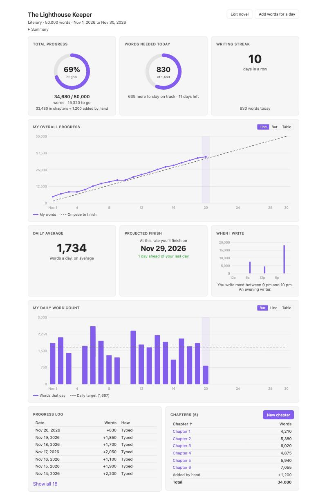
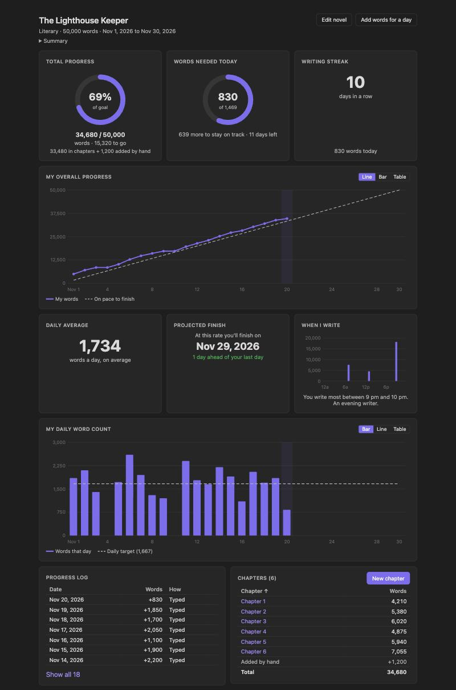
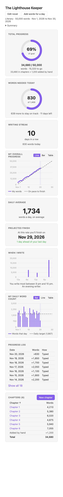

# Novel Goal Tracker

Track a novel's word count goal in Obsidian with a live dashboard of daily progress, streaks, and a projected finish date. Built for the classic 50,000-words-in-a-month challenge, and for any goal and timeframe you choose.



## Features

- **Setup wizard.** Give your novel a title, summary, word goal, and timeframe: this November, starting today for a number of days, or your own dates.
- **A folder per novel.** The plugin creates `Dashboard.md` and a `Chapters` folder. Every note in `Chapters` (sub-folders too) counts toward your novel.
- **Live word counts.** Counts update as you type, even in a 150,000-word novel.
- **A full dashboard**, modeled on the old NaNoWriMo novel stats page:
  - total progress and words needed today, as ring gauges
  - writing streak, daily average, and "at this rate you'll finish on…"
  - your total over time against an on-pace line
  - words per day, and the hours you write most
  - a progress log and a sortable chapter list
- **Side pane.** Keep the dashboard open beside the chapter you're writing.
- **Several novels at once**, each with its own folder and goal.
- **Works on desktop and mobile**, in light and dark themes.

## Getting started

1. Install **Novel Goal Tracker** from **Settings → Community plugins → Browse**, then enable it.
2. The setup wizard opens by itself the first time. Follow its five steps (see below) and choose **Create novel**.
3. Your dashboard opens. Click **Chapter 1** in its chapter list and start writing.

## Creating a novel

You can start a new novel at any time, from any of these three places:

| Where | How |
| --- | --- |
| **Ribbon** | Click the **book icon** (Novels) in the left ribbon, then **Create new novel**. |
| **Command palette** | Press **Cmd+P** (macOS) or **Ctrl+P** (Windows, Linux), type **Create new novel**, and press Enter. |
| **Settings** | Open **Settings → Novel Goal Tracker**. Under **Novels**, choose **Create new novel**. |

The wizard has five steps:

1. **Title.** This also names the novel's folder.
2. **Summary and genre.** Both are optional.
3. **Word goal.** 50,000 by default.
4. **Timeframe.** Choose this November, starting today for a number of days, or your own start and end dates. The wizard shows how many words a day that takes.
5. **Confirm.** Check the details and choose **Create novel**.

The plugin then creates the novel's folder:

```
<Novel title>/
  Dashboard.md      ← your dashboard
  Chapters/
    Chapter 1.md    ← start writing here
```

Every note in `Chapters` counts toward your novel, including notes in sub-folders. Add chapters with the **New chapter** button on the dashboard, or create notes in `Chapters` yourself.

**Already have a novel folder?** If a folder already contains a `Chapters` folder, for example one you stopped tracking, choose **Track existing novel folder** from the ribbon menu or the command palette. If the folder still has its `Dashboard.md`, its writing history comes back too.

## How words are counted

- **What counts as a word.** Words in your chapters, the way a reader would count them. Frontmatter, comments, code, math, links' targets, and Markdown symbols are left out. Links count their visible text. Chinese and Japanese count one word per character.
- **Words today** counts the words you typed or pasted today on this device. Deleting or trimming text never lowers it.
- **Your total** is the real word count of your chapters, plus any words you add by hand.
- **Sync never double-counts.** Text that arrives from another device or from another plugin changes your total, but not today's words.
- **Writing day.** You can start your writing day later than midnight, so late-night sessions count toward the day before.
- **Writing elsewhere?** Use **Add words for a day** to credit writing you did outside Obsidian.

## Commands

| Command | What it does |
| --- | --- |
| Create new novel | Opens the setup wizard |
| Open novel dashboard | Opens a novel's `Dashboard.md` (or click the book icon in the ribbon) |
| Open novel dashboard in side pane | Shows the dashboard beside your writing |
| Add words for a day | Credits words written outside Obsidian |
| Edit novel | Changes the title, summary, goal, dates, or folder |
| Track existing novel folder | Tracks a folder that already has a `Chapters` folder, for example after you stopped tracking it. Its history comes back. |

## Settings

- **Writing day starts at:** words written before this hour count toward the previous day.
- **Folder for new novels:** where new novel folders are created.
- **Count code** and **Count comments:** both off by default.
- **Novels:** open a dashboard, or stop tracking a novel. Stopping asks first and never deletes your files; run **Track existing novel folder** to track it again.

## Privacy

- No network requests, accounts, ads, or telemetry. Nothing leaves your vault.
- The plugin creates and edits only the novel folders you ask it to create.
- Settings and writing history are stored in the plugin's `data.json` inside your vault's plugin folder.
- Each device gets a random ID, kept in Obsidian's local storage for this vault, so synced devices don't overwrite each other's history.

## More screenshots

| Dark theme | Side pane |
| --- | --- |
|  |  |

## Development

```bash
npm install
npm run dev       # rebuild main.js on change
npm test          # unit tests, including a 150k-word performance test
npm run test:e2e  # Playwright: the real dashboard and plugin code in headless Chromium
npm run test:obsidian  # Playwright: drives the real Obsidian app (opens windows; macOS, Obsidian 1.13+)
npm run lint
npm run build     # production build
npm run preview   # build browser previews of the dashboard (scripts/preview)
```

To try a build, copy `main.js`, `manifest.json`, and `styles.css` into `<vault>/.obsidian/plugins/novel-goal-tracker/`.

## Acknowledgements

Inspired by the novel stats page of NaNoWriMo (National Novel Writing Month), which closed in 2025. This plugin is not affiliated with or endorsed by NaNoWriMo or its former organizers.

## License

[MIT](LICENSE)
